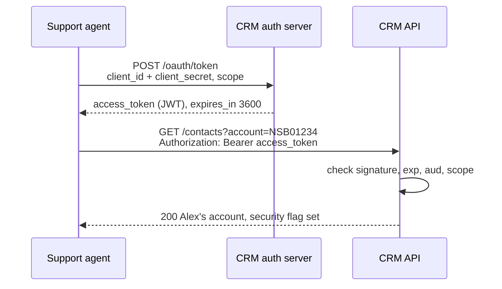
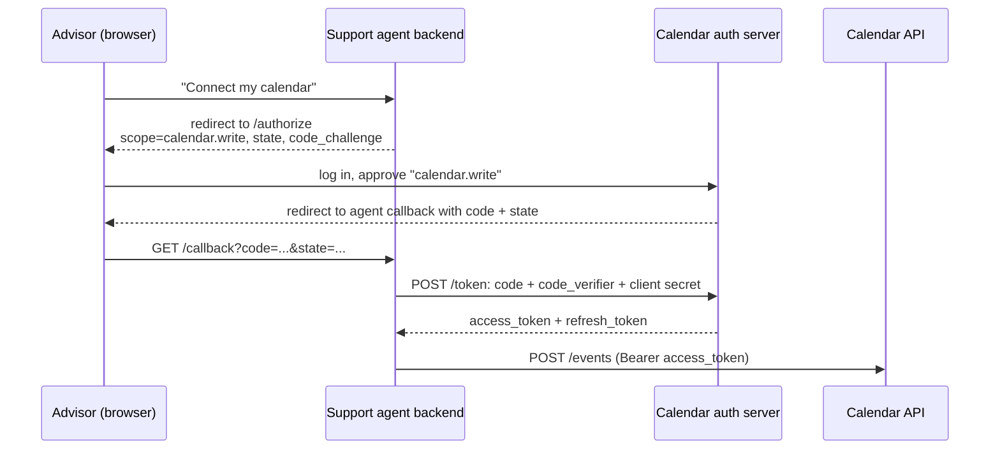

## TL;DR
"API keys, OAuth or JWT?" sounds like a choice between three options, but they sit on different layers. An **API key** is a credential: a long-lived secret you send with every request. **OAuth 2.0** is a protocol for *getting* a credential: you trade something you hold for a short-lived, scoped access token, either as yourself (client credentials) or on behalf of a person who consented (authorization code). A **JWT** is a *format*: a signed JSON token the API can check on its own, without a database call. An OAuth access token is often a JWT, which is why the three get mixed up. As the one calling an API, I mostly need to know which credential the API wants, how to get and refresh it, and how to keep it out of places it doesn't belong, including the model's context.

## Three answers to different questions

Every authenticated API call answers some version of three questions: *who is calling*, *on whose behalf*, and *how does the API know*. The three terms answer different ones.

| | What it is | What it answers | Lifetime |
|---|---|---|---|
| **API key** | A credential | "This request comes from application X" | Months, until someone rotates it |
| **OAuth 2.0** | A protocol for getting credentials | "Application X may do *these things*, as itself or for user Y" | Access token: minutes to an hour |
| **JWT** | A token format | "Here's who issued this, for whom, until when, and a signature proving it" | Whatever its `exp` claim says |

So the honest comparison is not API key vs OAuth vs JWT. It is *static secret* vs *short-lived token*, and, for tokens, *opaque string* vs *self-contained JWT*.

## The running example

The running example is the invented Northstar Bank from my posts on support automation. Alex Carter writes in that their account is locked, and the support agent has to call three systems to help:

1. **A ticketing system**, to open an escalation ticket. It takes an **API key**.
2. **The CRM**, to look up Alex's account and check the security flag. It speaks **OAuth 2.0** and hands out access tokens that are **JWTs**.
3. **The calendar of Alex's personal advisor**, to book a callback. That is the advisor's data, so the agent needs the advisor's **consent**, via OAuth's authorization code flow.

Same agent, three integrations, three patterns.

## API keys: one secret, one header

The ticketing system's admin generates a key in its settings page and gives it to us. From then on, every request carries it:

```http
POST /v2/tickets HTTP/1.1
Host: api.ticketing.example.com
Authorization: Bearer tk_live_4f9a...e21c
Content-Type: application/json

{"subject": "Locked account, security flag set", "customer_id": "NSB01234", "priority": "high"}
```

Some APIs want the key in a custom header (`X-API-Key: ...`) or as the username of HTTP Basic auth; the docs say which. The server looks the key up in its database, finds the account it belongs to, and lets the request through.

That is the whole mechanism, and its simplicity is the point: nothing to fetch, nothing expires mid-conversation, a `curl` with one header works. The costs follow from the same simplicity:

- **It identifies an application, not a person.** The ticket gets created "by the integration", whoever the agent is talking to.
- **It is long-lived.** A key leaked into a log file or a Git commit works until someone notices and rotates it. Rotation is manual, and often means a short window where both old and new key must be valid.
- **It is often all-or-nothing.** Some platforms let you scope a key (read-only, one project); many don't.
- **It goes in a header, never in the URL.** Query strings end up in proxy logs, browser history and analytics.

API keys are a fine fit for server-to-server calls where the calling application *is* the actor, the key lives in a secrets manager, and the API offers nothing better.

## OAuth 2.0: trade a secret for a short-lived token

OAuth fixes the long-lived part by adding a middleman. There are four roles:

- the **resource server**: the API with the data (the CRM's API);
- the **client**: the application calling it (our support agent);
- the **authorization server**: issues tokens (the CRM's login service);
- the **resource owner**: whoever the data belongs to; the advisor, for the calendar.

The client never sends its long-lived secret to the API. It sends it, once in a while, to the authorization server, and gets back an **access token**: valid for minutes to an hour, and limited to the **scopes** that were granted, like `contacts.read`. Every API call carries the access token. If one leaks, it is useless within the hour.

How the client gets that token is the **grant type**. Two cover almost every integration.

### Client credentials: the agent as itself

The CRM integration has no human in it: the agent reads accounts as itself. That is the **client credentials** grant. The CRM admin registers our agent as a client and gives us a `client_id` and a `client_secret`.



The token request is a form-encoded `POST`, with the client authenticating via HTTP Basic:

```http
POST /oauth/token HTTP/1.1
Host: auth.crm.example.com
Authorization: Basic base64(client_id:client_secret)
Content-Type: application/x-www-form-urlencoded

grant_type=client_credentials&scope=contacts.read%20cases.write
```

```json
{
  "access_token": "eyJhbGciOiJSUzI1NiIsInR5cCI6IkpXVCIsImtpZCI6ImNybS0yMDI2LTEwIn0.eyJpc3Mi...",
  "token_type": "Bearer",
  "expires_in": 3600,
  "scope": "contacts.read cases.write"
}
```

Then every CRM call sends `Authorization: Bearer <access_token>`, until it expires. There is no refresh token here: the agent still has its client secret, so it simply asks for a new token.

Two things are easy to get wrong:

- **Cache the token.** Fetching a fresh one per API call doubles the latency, and many authorization servers rate-limit the token endpoint. Keep it until shortly before `expires_in` runs out, and fetch a new one on a `401`.
- **This looks a lot like an API key, still.** The `client_secret` is long-lived too. What OAuth buys is that the secret travels to one endpoint occasionally rather than on every call, that what *does* travel expires, and that it carries scopes. Some providers go further and replace the secret with a signed JWT (more on that below), so nothing reusable travels at all.

### Authorization code: the agent on someone's behalf

The calendar belongs to the advisor. The agent shouldn't hold a key that opens *every* advisor's calendar; it should act for the advisors who agreed to it, and only on their calendars. This delegation is what OAuth was built for, and it is the flow behind every "Sign in with…" and "Allow this app to…" screen: the **authorization code** grant.



The steps:

1. The advisor clicks "Connect my calendar" once. The agent's backend redirects their browser to the authorization server, listing the scopes it wants.
2. The advisor logs in *at the calendar provider*, never at our app, and approves. The agent never sees their password.
3. The browser is redirected back with a one-time **code**. The backend exchanges it, together with its own client credentials, for an access token and a **refresh token**.
4. When the access token expires, the backend trades the refresh token for a new one (`grant_type=refresh_token`) without bothering the advisor.

Two parameters in step 1 matter for security. `state` is a random value the backend checks on the way back, so an attacker can't splice their own code into someone else's session. `code_challenge` is **PKCE**: the backend hashes a random `code_verifier`, sends the hash up front and the verifier at the exchange, so a code intercepted on the way back is useless on its own. PKCE started as a fix for mobile apps and is now recommended for every client.

The refresh token is the long-lived secret in this flow. It goes in the secrets store, one per advisor, and many providers **rotate** it: every refresh returns a new refresh token and invalidates the old one. An integration that forgets to store the new one works for exactly one hour and then breaks.

### The grants you can skip

OAuth's original spec has two more grants, and current best practice ([RFC 9700](https://datatracker.ietf.org/doc/html/rfc9700)) says not to use them: the **implicit** grant, which returned the token in the URL, and the **password** grant, where the client collected the user's password itself, which defeats the point. The **device** grant, for TVs and command-line tools that show a code to type in elsewhere, is legitimate but rarely comes up in a backend integration.

## JWT: a token the API can check on its own

The CRM's access token above starts with `eyJ`. That is the giveaway: `eyJ` is base64 for `{"`, and the token is a **JSON Web Token**. It has three base64url parts separated by dots, `header.payload.signature`. Decoded, the first two of our token read:

```json
{ "alg": "RS256", "typ": "JWT", "kid": "crm-2026-10" }
```

```json
{
  "iss": "https://auth.crm.example.com",
  "sub": "support-agent",
  "aud": "https://api.crm.example.com",
  "scope": "contacts.read cases.write",
  "iat": 1792310400,
  "exp": 1792314000
}
```

The payload's fields are **claims**. `iss` is who issued it, `sub` who it is about (our agent, or a user in a delegated flow), `aud` which API it is for, `iat` and `exp` when it was issued and when it expires (Unix seconds; this one lives one hour), and `scope` what it allows.

The third part is a signature over the first two, made with the authorization server's private key. That is what JWTs buy: the CRM API can check the token **without asking anyone**. It fetches the authorization server's public keys once (they are published as a **JWKS**, a JSON Web Key Set, at a well-known URL), picks the key named by `kid`, and verifies the signature locally. No database lookup per request, which is why JWTs are popular in systems with many APIs behind one login.

### A JWT is signed, not encrypted

Anyone holding the token can read the payload: paste it into a decoder and the claims appear. The signature only proves nobody *changed* them. So no secrets go into claims, and the token itself is as good as a password until `exp`: whoever holds it can use it.

### Checking one

If you are the API receiving a JWT, verification is more than checking the signature. In Python with [PyJWT](https://pyjwt.readthedocs.io/):

```python
import jwt  # PyJWT

jwks = jwt.PyJWKClient("https://auth.crm.example.com/.well-known/jwks.json")

def verify(token: str) -> dict:
    signing_key = jwks.get_signing_key_from_jwt(token)  # picks the key by "kid"
    return jwt.decode(
        token,
        signing_key.key,
        algorithms=["RS256"],                    # never trust the token's own "alg"
        audience="https://api.crm.example.com",  # minted for this API, not another one
        issuer="https://auth.crm.example.com",   # by the server we trust
        leeway=30,                               # tolerate small clock skew
        options={"require": ["exp", "iss", "aud"]},
    )
```

Each argument closes a known hole:

- **`algorithms`** pins the algorithm. Early libraries trusted the token's header, so an attacker could set `"alg": "none"` and drop the signature, or switch `RS256` to `HS256` and sign with the *public* key as if it were a shared secret.
- **`audience`** stops a token minted for the ticketing API from being replayed against the CRM.
- **`require`** rejects tokens that simply leave `exp` out and would otherwise never expire.

### The price: you can't take it back

A token the API checks on its own is also a token the API can't revoke on its own. If an access token leaks, it stays valid until `exp`. That is why access tokens are short-lived and why the refresh token, which the authorization server *does* check on every use, carries the long-lived trust. The alternative is an **opaque** token, a random string that the API checks by asking the authorization server ([token introspection](https://datatracker.ietf.org/doc/html/rfc7662)). It is revocable at once, at the cost of a network call per request.

### As the caller, the token is opaque to you

The agent *calling* the CRM doesn't need to decode its access token at all: it is addressed to the CRM API (`aud`), and the provider can change its format any time. The agent needs `expires_in` from the token response and nothing else. Decoding it is still the fastest way to debug a `403`: the `scope` or `aud` is usually wrong.

### Where else JWTs show up

- **As the client's credential.** Some providers replace the `client_secret` with a JWT the client signs with its own private key ([RFC 7523](https://datatracker.ietf.org/doc/html/rfc7523)). Service accounts in large cloud and CRM platforms work like this: you upload a public key once, and the secret that travels is a signed assertion valid for a few minutes.
- **As an ID token.** **OpenID Connect** adds login on top of OAuth: alongside the access token, the authorization server returns an **ID token**, a JWT that tells the *client* who the user is. The access token is for the API; the ID token is for the client. Sending an ID token to an API as if it were an access token is a classic mix-up.

## When a call fails: 401 or 403

The status code says which layer failed:

- **`401 Unauthorized`** means "I don't know who you are": the token is missing, malformed, expired or signed by someone the API doesn't trust. The fix is a new token. A well-behaved client fetches one and retries *once*.
- **`403 Forbidden`** means "I know who you are, and you may not do this": a missing scope, or a role the agent's client doesn't have. A new token with the same grants won't help; the fix is in the client's configuration, usually on the provider's side.

Retrying a `403` in a loop is a bug.

## Credentials stay out of the model

An LLM agent adds a rule none of these specs mention: **the model never sees a credential.** The model chooses a tool and its arguments, like `lookup_account(account_number="NSB01234")`. The tool's code fetches the cached token from the secrets store, attaches the header and makes the call. Nothing the model could repeat, log or be talked out of by a [prompt injection](/post/prompt-injection) ever enters its context.

The same split decides whose permissions apply. Alex never logs in to the CRM, so the CRM can't check what *Alex* may see; it only sees the agent's service identity, with all of its scopes. Whether this caller may hear about this account is a check the integration code has to make, before the call, in code rather than in the prompt. [Workflow or Agent](/post/workflow-vs-agent) argues the same for the order of operations.

## Reading a new API's auth docs: my checklist

1. **Which credential does it want?** An API key, an OAuth access token, or something else: HTTP Basic, mutual TLS, a signed request.
2. **If OAuth: which grant?** Is there a human whose data this is (authorization code), or does the integration act as itself (client credentials)?
3. **Where is the token endpoint, and how does the client authenticate there?** Secret in the body, Basic header, or a signed JWT. The provider's `/.well-known/openid-configuration` or `/.well-known/oauth-authorization-server` lists it.
4. **Which scopes do I need, at minimum?** Ask for those and no more.
5. **How long do tokens live, and do refresh tokens rotate?** That decides the caching and storage code.
6. **What does a `401` and a `403` look like here?** Some APIs return `400` with an error body instead.
7. **Who rotates which secret, and how?** Write it down before go-live, not after the first expiry.

## Sources

- [RFC 6749](https://datatracker.ietf.org/doc/html/rfc6749): the OAuth 2.0 framework, with the grant types.
- [RFC 6750](https://datatracker.ietf.org/doc/html/rfc6750): bearer tokens, the `Authorization: Bearer` header and the `401`/`403` error codes.
- [RFC 7636](https://datatracker.ietf.org/doc/html/rfc7636): PKCE.
- [RFC 9700](https://datatracker.ietf.org/doc/html/rfc9700): current OAuth security best practice.
- [RFC 7519](https://datatracker.ietf.org/doc/html/rfc7519): JSON Web Token, and [RFC 9068](https://datatracker.ietf.org/doc/html/rfc9068): JWTs as OAuth access tokens.
- [RFC 8725](https://datatracker.ietf.org/doc/html/rfc8725): JWT best practices, including the algorithm attacks.
- [OpenID Connect Core](https://openid.net/specs/openid-connect-core-1_0.html): ID tokens.
